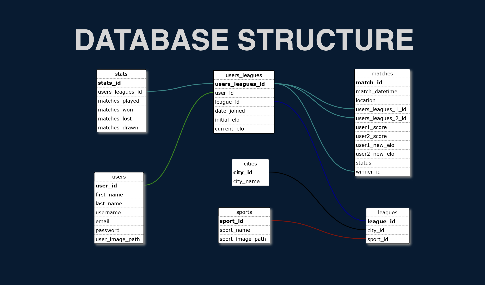

# Versus - Connecting Casual Athletes

Versus is a mobile platform that connects casual athletes by the sports they love to play.

## Features

- Join leagues for various 1:1 sports
- Participate in city-wide rankings powered by ELO-based scoring
- Challenge other players within your league
- Track and visualise your performance over time with progress charts

## Repositories

The Versus platform is split into two repositories:
- [Frontend](https://github.com/OliWalker/versus-fe) (built with React and D3)
- [Backend](https://github.com/rezziemaven/versus-be) (built with Koa and MariaDB)

This project is the **backend** for the platform.

## Tech Stack

- [Node.js](https://nodejs.org/en) + [Koa](https://koajs.com/) (server framework)
- [MariaDB](https://mariadb.org/) (pure SQL — no ORM)

## Database model

## Prerequisites

- NVM (for switching to the right Node version for this project)
- Node.js (see `.nvmrc` for Node version)
- MariaDB

## Optional
- [Postman](https://www.postman.com/) (API testing)

## Getting Started

1. Clone the repository.
2. In the root folder of the project, run `nvm use`, then run `npm install`.
3. Set up a database in MariaDB for the server (eg. `versus_dev`) and optionally add a separate user for the database if necessary, making sure to grant all privileges.
4. Copy `.env.example` to `.env` and fill in the expected values.
5. Run `npm run import-dump` to setup the database schema and import dummy content into the database.
6. Run `npm run dev` to start the server, or use your favourite package manager (yarn, pnpm, bun) to start the server instead.

## API Documentation

- [Postman Collection](./docs/Versus.postman_collection.json)
- [Apiary](https://versus3.docs.apiary.io/) (Available until Oct 31st 2026, as Apiary is being put to end of life)

## Future Improvements

- Add test coverage
- Add OAuth support for third-party authentication providers (e.g. Google, Apple)
- Migrate API docs from Apiary to OpenAPI format 
- Refactor into service-based folder structure
- Create `schema.sql` and add script to import clean schema into new database
